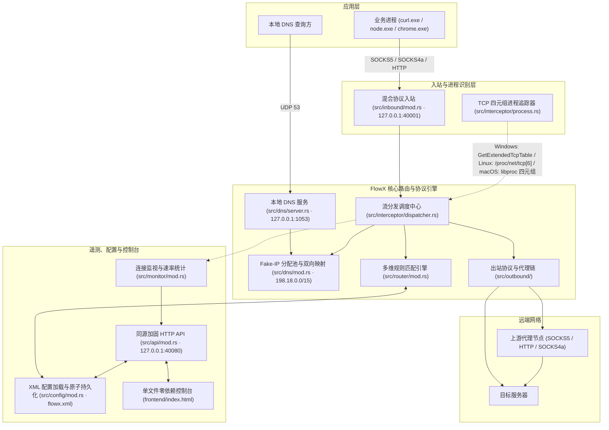

# FlowX 核心架构与工程规范 (FlowX Architecture & Engineering Specification)

FlowX 是一套基于 Rust（Edition 2024）构建的跨平台（Windows / Linux / macOS）进程级透明网络代理与分流引擎。本文档描述当前代码实现的真实系统拓扑、核心模块职责及后续演进路线。

---

## 1. 系统总体架构与拓扑

FlowX 采用分层解耦的设计，包含入站接管与进程追踪、核心路由与协议引擎、配置持久化以及内嵌 Web 控制台四大平面：

---

## 2. 已实现核心模块

### 2.1 混合协议入站与回环防护 (`src/inbound/mod.rs`, `src/interceptor/dispatcher.rs`)
- **单端口多协议嗅探**：在 `127.0.0.1:40001` 上通过首字节自动识别 `SOCKS5`、`SOCKS4 / SOCKS4a`、`HTTP CONNECT` 与 `HTTP` 绝对 URI 明文转发请求；拒绝 `HTTP/1.0` 携带 `Transfer-Encoding`、`Host` 与请求 URI 不一致等走私畸形报文。
- **有界 HTTP 装帧与安全改写**：从代理握手报文中提取真实目标地址与端口；对 `HTTP` 明文转发自动改写为 origin-form，剥离逐跳代理头并强制 `Connection: close`，在出站端按 `Content-Length` / 严格 `Transfer-Encoding: chunked` 状态机完成有界请求体转发并隔离多余前导字节（防止同连接 HTTP 流水线走私），同时保持上游写半关闭行为兼容延迟应答与早期 `4xx` 响应。
- **自连回环防护**：拒绝目标指向 FlowX 自身服务端口（`40001` / `40080` / `1053`）与本机接口地址的请求，杜绝自连死循环。

### 2.2 进程四元组精确追踪 (`src/interceptor/process.rs`)
- **Windows 实现**：调用 `GetExtendedTcpTable` 按字节偏移安全读取表项与完整四元组（`local == client && remote == server`）精确检索归属 PID，再通过 `QueryFullProcessImageNameW` 获取完整可执行路径。
- **Linux 实现**：严格校验 `/proc/net/tcp`（及双栈套接字使用的 `/proc/net/tcp6` `::ffff:` 映射地址）十六进制/数字格式并按同一四元组定位套接字 inode，扫描 `/proc/<pid>/fd` 中指向 `socket:[inode]` 的描述符得到 PID（优先探测 PID 缓存中的活跃进程，未命中再全量遍历），最后读取 `/proc/<pid>/exe`（自动剥离 ` (deleted)` 后缀），权限不足时依次回退 `cmdline` 与 `comm`。`windows-sys` 仅在 Windows 目标编译，Linux 构建零额外依赖。
- **macOS 实现**：基于 `libproc` (`proc_listpids`、`proc_pidfdinfo(PROC_PIDFDSOCKETINFO)` 与 `proc_pidinfo(PROC_PIDTBSDINFO)`) 按四元组反查归属 PID 与可执行路径；`matches_macos_socket_info` 同时兼容单栈与 `INI_IPV4 | INI_IPV6` 双栈套接字，并在 `proc_pidinfo` 返回 `< 0` 时检查 `EPERM`/`EACCES` 写入负缓存（避免误读 `0` 返回时的陈旧 `errno`）。
- **二级 TTL 缓存**：结合 1 秒连接缓存与 10 秒 PID 路径缓存（启动时间校验防 PID 复用，拒绝缓存短命进程 Unknown），并通过 `spawn_blocking` 隔离阻塞式系统调用与文件系统扫描，避免阻塞 Tokio 调度线程。

### 2.3 DNS 拦截与 Fake-IP 机制 (`src/dns/mod.rs`, `src/dns/server.rs`)
- **本地 DNS 服务**：监听 `127.0.0.1:1053`（4096 字节 UDP 接收缓冲），豁免 Windows `WSAECONNRESET` (`ConnectionReset`) 与瞬时 `WouldBlock`/`Interrupted` 接收错误（连续突发错误通过周期性 `yield_now()` 防止 CPU 自旋），默认拦截阻断 `AAAA`（Type 28）、`SVCB`（Type 64）与 `HTTPS`（Type 65）查询并回复空 NOERROR 应答，防止 IPv6 泄漏与 `ipv4hint` 绕过 Fake-IP；其余查询通过独立内部事务 ID 映射器（校验来源 IP 与 Question，防污染与超时丢包）复用上游 UDP 套接字转发至 `223.5.5.5:53`，并通过上游信号量限制并发。
- **Fake-IP 滑动续期**：为 `A` 查询从 `198.18.0.0/15` 分配虚拟 IP 并维护双向映射；在 `allocate()` / `restore()` 命中活跃域名时自动滑动续期 TTL，防止活跃会话中途丢失域名映射。

### 2.4 多维规则路由引擎 (`src/router/mod.rs`, `src/router/parser.rs`)
- **多维条件**：支持应用程序名/路径 Glob 通配符（分号分隔，`.exe` 后缀跨平台双向兼容）、目标域名通配与 IPv4/IPv6 CIDR 网段、离散端口与端口范围（如 `80; 443; 8000-8080`）；`%ComputerName%` / `%HOSTNAME%` 在按 `;` 拆词后按 `COMPUTERNAME` → `HOSTNAME` → `/proc/sys/kernel/hostname` → `/etc/hostname` 顺序解析并拦截分号/通配符/CIDR 注入，仅编译为 `Exact` 字面量匹配。
- **动作与顺序**：支持 `Direct`、`Block`、`Proxy(node_id)` 与 `Chain(chain_id)`；采用自顶向下 First-Match Wins 求值与不可变快照 CoW 更新，末尾提供可动态热更新的兜底默认动作（`set_default_action`）。
- **动态管理与干跑诊断**：支持运行时新增、删除、原地更新（`update_rule`，保留规则 ID、启用状态与优先级顺序）、启停开关（`toggle_rule`）、优先级调整（`move_rule`：`up` / `down` / `top` / `bottom`）以及干跑路由模拟器（`simulate`，输出命中规则与逐条未命中原因轨迹）。

### 2.5 多协议出站与代理链 (`src/outbound/`)
- **协议与上游 DNS 防护**：`DirectOutbound`、`Socks5Client`（RFC 1928/1929 账密认证）、`HttpConnectClient`（Basic 认证、`username` 禁冒号、CRLF 与非法目标字符校验）与 `Socks4Client`（含 SOCKS4a 域名扩展）统一通过上游 UDP DNS 解析并经 `validate_direct_ips` 过滤 Fake-IP（`198.18.0.0/15`）、回环及本机接口上的 FlowX 服务端口，支持多 IP 有限故障转移。
- **多跳代理链 (`ProxyChain`)**：支持在已有隧道流上递归握手串联多跳节点，在构建期与中间跳拨号期统一执行循环检测、`local_interface_ips()`/`self_ports`/Fake-IP 防护与全链路超时控制。
- **流量监视中继**：全双工对拷采用双向同时静默 120 秒空闲超时与半关闭持续传输支持（内部统一超时看门狗），并具备实时手动熔断切断通知。

### 2.6 配置持久化、双栖 CLI 与同源加固控制台 (`src/config/mod.rs`, `src/api/mod.rs`, `src/cli.rs`, `frontend/index.html`)
- **XML 配置 (`flowx.xml`) 与凭证成对校验**：支持通过 `--config <路径>` 或环境变量 `FLOWX_CONFIG` 指定配置文件，Unix 下强制 `0600` 权限落盘；对 `HTTP`/`SOCKS5` 强制用户名与密码成对存在（清空密码同步清除用户名），`SOCKS4` 保留可选 `UserID`，并禁止保存指向 Fake-IP 或自身服务端口的节点。
- **API 安全加固、分级回滚与并发防护**：强制 `Host` 回环白名单（防 DNS Rebinding）与 `Origin` / `Referer` / `Sec-Fetch-Site` 同源校验（防 CSRF），`408`/`503` 有界错误响应；所有写接口持有异步 `mutation_lock`，先构建暂存副本并用 `tokio::task::spawn_blocking` 串行化原子写回磁盘，写盘失败时返回 `500 ERR_CONFIG_PERSIST_FAILED` 且不污染内存运行状态。提供节点增删改与按 ID 测速（`GET/POST/PUT/PATCH/DELETE /api/nodes`、`POST /api/nodes/ping`）、规则增删改与排序启停（`GET/POST/PUT/PATCH/DELETE /api/rules`、`POST /api/rules/toggle`、`POST /api/rules/move`）、默认兜底切换（`POST /api/rules/default`）及路由命中模拟（`POST /api/rules/simulate`）。
- **双栖 CLI 控制子命令 (`src/cli.rs`)**：支持 `flowx status | node | rule | default | sim | conn` 及 `--json` 结构化错误/输出（统一支持别名冲突校验），在线调用本地 HTTP API（带 `--api` 严格地址规范检查），只读离线命令绝不新建缺失配置，离线变更先在内存中校验后再写盘，并配套内置 Agent 技能定义（`skills/flowx/SKILL.md`）与模板 `flowx.example.xml`。
- **内嵌现代 Web 控制台**：单文件零外部依赖 HTML/CSS/JS（`include_str!` 打包，支持中英双语、深浅主题与模态框实时重译），提供无竞态轮询控制（单调序列令牌防陈旧响应覆盖与暂停定时器清理）、60 秒实时吞吐 SVG 折线图、连接过滤与切断、节点成对凭证表单与并发保护测速、IPv6 `[host]:port` 格式化、规则新增/编辑/启停/排序、默认兜底动作切换以及交互式路由规则命中模拟器。

---

## 3. 演进路线（规划中）

- **驱动级透明接管**：Windows 集成 `wintun.dll` 或 WinDivert，Linux 基于 `nftables` / `iptables` `TPROXY` 或 TUN 设备，实现无需业务进程显式配置代理端口的系统级透明流量重定向与 UDP 转发。
- **代理链可视化编排**：在 Web 控制台中开放多跳 `ProxyChain` 的创建与管理界面。
- **桌面壳包装**：可选基于 Tauri 封装为独立桌面托盘应用。
