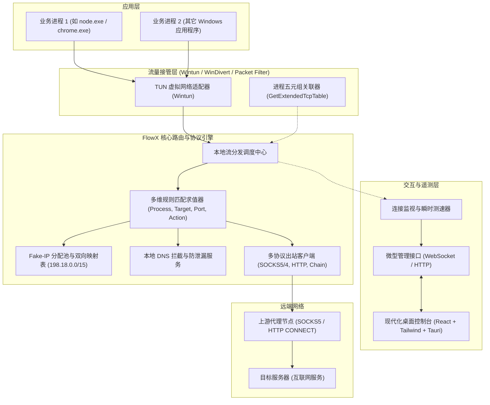

# FlowX 核心架构与工程设计规范 (FlowX Architecture & Engineering Specification)

FlowX 是一套基于 Rust 构建的现代透明网络重定向与进程级分流引擎。本文档阐述 FlowX 的系统拓扑、核心技术实现与工程规范。

---

## 1. 系统总体架构与拓扑

FlowX 采用分层解耦的现代化网络软件设计，包含四大核心平面：

---

## 2. 核心模块与功能设计

### 2.1 流量拦截与进程关联 (Traffic Interception & Process Tracking)
- **底层驱动**：通过 WireGuard 官方经过 Windows 签名的 `wintun.dll` 建立虚拟网卡，保证驱动层的绝对安全与零蓝屏风险。
- **进程追踪**：通过 Windows IP Helper API（`GetExtendedTcpTable` / `GetExtendedUdpTable`）结合本地套接字，以高频只读缓存形式毫秒级关联到发起连接的进程 PID 与执行路径（`QueryFullProcessImageNameW`）。

### 2.2 DNS 虚拟化与 Fake-IP 机制
- 拦截系统对外的 UDP 53 DNS 解析请求。
- 命中代理规则的域名不进行本地公网解析，而是从保留测试网段 `198.18.0.0/15` 中动态分配一个独一无二的 Fake-IP，并缓存双向映射关系（`Domain <-> Fake-IP`）。
- 当进程尝试对该 Fake-IP 建立 TCP 连接时，引擎查表逆向还原真实域名，并在向上游代理发起握手时直接附带域名（例如 SOCKS5 的 `ATYP=0x03`），彻底避免 DNS 污染与本地 IP 泄漏。

### 2.3 多维规则路由引擎 (Multi-Dimensional Routing Engine)
- **进程匹配**：支持应用程序文件名与 Glob 通配符（例如 `*antigravity*.exe; node.exe`）。
- **目标地址**：支持 IPv4/IPv6 CIDR 子网掩码、域名通配符（`*.github.com`）以及精确域名。
- **端口过滤**：支持离散端口（`80; 443`）与端口范围（`8000-8088`）。
- **策略动作**：
  - `Direct`：直连放行。
  - `Block`：立即静默阻断或重置连接。
  - `Proxy`：重定向至指定代理服务器。
  - `Chain`：通过多跳级联代理链进行转发。
- **决策顺序**：自顶向下严格按顺序求值（First-Match Wins），末尾提供默认兜底规则。

### 2.4 多协议出站客户端与代理链 (Outbound Protocols & Chaining)
- **SOCKS5 (RFC 1928 / RFC 1929)**：支持无认证与用户名/密码认证；支持 IPv4、IPv6 与域名地址类型。
- **HTTP / HTTPS CONNECT (RFC 7231)**：支持通过 HTTP 代理建立全双工 TCP 隧道。
- **SOCKS4 / SOCKS4a**：兼容经典协议及远程域名扩展。
- **代理链 (Chaining)**：在既有代理隧道上递归嵌套下一个代理握手，实现多重跳板链路。

### 2.5 现代化控制台 (Modern Presentation)
- 彻底告别传统陈旧的 MFC 界面，采用 **Tauri + 现代化 Web 前端（Vite + React + Tailwind CSS + Lucide Icons）**。
- 提供深色/浅色极简美学、平滑动效、实时网络吞吐曲线图、连接列表动态测速与一键断开功能。
