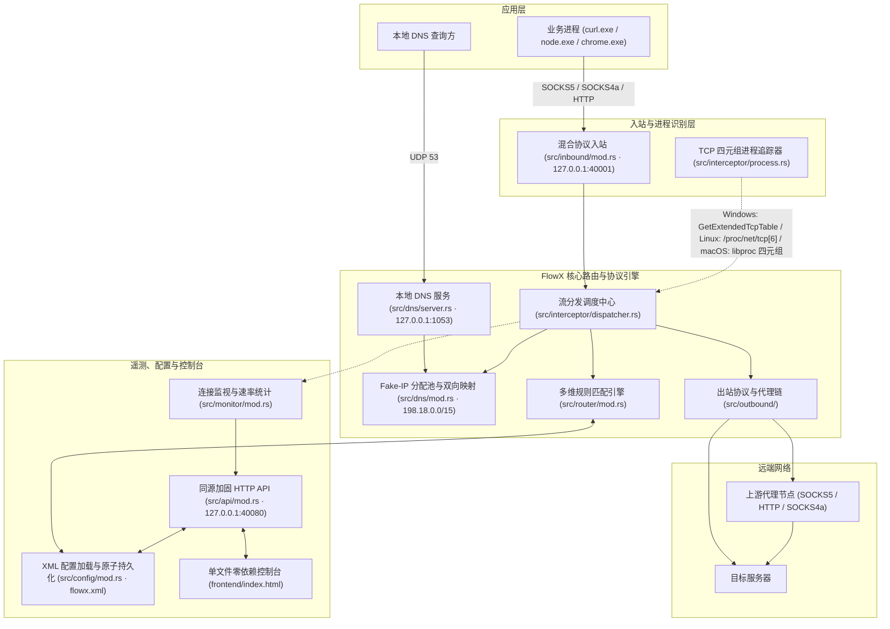

# FlowX 核心架构与工程规范 (FlowX Architecture & Engineering Specification)

FlowX 是一套基于 Rust（Edition 2024）构建的跨平台（Windows / Linux / macOS）进程级透明网络代理与分流引擎。本文档描述当前代码实现的真实系统拓扑、核心模块职责及后续演进路线。

---

## 1. 系统总体架构与拓扑

FlowX 采用分层解耦的设计，包含入站接管与进程追踪、核心路由与协议引擎、配置持久化以及内嵌 Web 控制台四大平面：

---

## 2. 已实现核心模块

### 2.1 混合协议入站与回环防护 (`src/inbound/mod.rs`, `src/interceptor/dispatcher.rs`)
- **单端口多协议嗅探**：在 `127.0.0.1:40001` 上通过首字节自动识别 `SOCKS5`、`SOCKS4 / SOCKS4a`、`HTTP CONNECT` 与 `HTTP` 绝对 URI 明文转发请求；严格将请求头读取上限限制在 `MAX_HTTP_HEADER`（64 KiB，超出或未闭合返回 `431`），拒绝 `HTTP/1.0` 携带 `Transfer-Encoding`、请求路径控制字符（`0x00..=0x1F`/`0x7F`）及 `Host` 头与目标权威端口（明文 HTTP 默认 `80`、`CONNECT` 强制显式端口）不一致等走私畸形报文。
- **有界 HTTP 装帧与双向流闭合**：从代理握手报文中提取真实目标地址与端口；对 `HTTP` 明文转发自动改写为 origin-form，剥离逐跳代理头并强制 `Connection: close`，在出站端按 `Content-Length` / 严格 `Transfer-Encoding: chunked` 状态机完成有界请求体转发并隔离多余前导字节（防止同连接 HTTP 流水线走私），下行 `relay_http_response_downlink` 解析 `1xx` 过渡帧与 HTTP/1.x 响应头/有界响应体（`HEAD`/`204`/`304`、`chunked`、`Content-Length`）并将 `Connection: keep-alive` 改写为 `Connection: close`，响应完毕立即优雅收尾以免忽略 `Connection: close` 的源站挂起至 120s 空闲超时，同时兼容延迟应答与早期 `4xx` 响应。
- **自连回环防护**：拒绝目标指向 FlowX 自身服务端口（`40001` / `40080` / `1053`）与本机接口地址的请求，杜绝自连死循环；连接目标按 `TargetAddr::to_authority_string()` 输出标准 `[ipv6]:port` 权威格式。

### 2.2 进程四元组精确追踪 (`src/interceptor/process.rs`)
- **Windows 实现**：调用 `GetExtendedTcpTable` 按字节偏移安全读取表项与完整四元组（`local == client && remote == server`）精确检索归属 PID，再通过 `QueryFullProcessImageNameW` 获取完整可执行路径（遇 `ERROR_INSUFFICIENT_BUFFER` 动态倍增缓冲至多 `32768` 宽字符）；`local_interface_ips()` 使用 8 字节对齐的 `Vec<u64>` 缓冲区调用 `GetAdaptersAddresses`。
- **Linux 实现**：严格校验 `/proc/net/tcp`（及双栈套接字使用的 `/proc/net/tcp6` `::ffff:` 映射地址）十六进制/数字格式并提取 `(inode, uid)`；扫描 `/proc/<pid>/fd` 时优先探测缓存热点 PID 与同 `uid` 进程，必要时回退其余进程以兼容跨 UID fd 继承/传递；读取 `/proc/<pid>/exe`（自动剥离 ` (deleted)` 后缀），权限不足时依次受限读取前 `4096` 字节 `/proc/<pid>/cmdline`（剥离控制符取 `argv[0]`）及清洗 `/` 与控制字符后的 `/proc/<pid>/comm`。Unix 目标（Linux/macOS）统一依赖 `libc`，`windows-sys` 仅在 Windows 目标编译。
- **macOS 实现**：基于 `libproc` (`proc_listpids`、`proc_pidfdinfo(PROC_PIDFDSOCKETINFO)` 与 `proc_pidinfo(PROC_PIDTBSDINFO)`) 按四元组反查归属 PID 与可执行路径；`matches_macos_socket_info` 同时兼容单栈与 `INI_IPV4 | INI_IPV6` 双栈套接字，并在 `proc_pidinfo` 返回 `< 0` 时检查 `EPERM`/`EACCES` 写入负缓存（避免误读 `0` 返回时的陈旧 `errno`）。
- **有界缓存与并发隔离**：采用 **10 秒进程身份缓存 (`pid_cache`) 与 6 秒权限受限负缓存 (`neg_pid_cache`)**（容量上限各 `1024`，绑定启动时间校验防 PID 复用且不缓存短命进程 `Unknown`），并通过 `Semaphore(8)`（`200ms` 等待上限）与 `spawn_blocking` 隔离阻塞式系统调用及文件系统扫描，避免阻塞 Tokio 调度线程。

### 2.3 DNS 拦截与 Fake-IP 机制 (`src/dns/mod.rs`, `src/dns/server.rs`)
- **本地 DNS 服务**：监听 `127.0.0.1:1053`（4096 字节 UDP 接收缓冲），豁免 Windows `WSAECONNRESET` (`ConnectionReset`)、瞬时 `WouldBlock`/`Interrupted` 以及 UDP 超长包截断错误（Windows `WSAEMSGSIZE` / `10040`、Unix `libc::EMSGSIZE`），连续突发错误通过周期性 `yield_now()` 防止 CPU 自旋。默认在本地 Fake-IP DNS 服务侧阻断 `AAAA`（Type 28）、`SVCB`（Type 64）与 `HTTPS`（Type 65）查询并回复空 NOERROR 应答防泄漏；实际出站拨号（`DirectOutbound`）与节点在线测速（`ping_address_with_context`）策略对称一致，均按 `A + AAAA`（`include_ipv6 = true`）向 `223.5.5.5:53` 解析并支持纯 IPv6 域名节点；每次上游查询绑定临时本地 UDP 套接字（ephemeral port）并生成 CSPRNG 随机 16-bit 事务 ID，严格校对响应源地址与 Question 后通过上游信号量限制并发。
- **Fake-IP 滑动续期与 $O(\log N)$ 淘汰**：为 `A` 查询从 `198.18.0.0/15` 分配虚拟 IP 并维护双向映射，兼容统一 `FakeIpPool::unwrap_ipv4` 识别 `[::ffff:198.18.0.x]` 双栈表示；在 `allocate()` / `restore()` 命中活跃域名时自动滑动续期 TTL，内部维护 `BinaryHeap<Reverse<(Instant, u64, u32)>>` 过期优先最小堆与单调序列号 `alloc_seq`（含陈旧堆条目懒跳过与 4 倍阈值重建），在池满时以均摊 $O(\log N)$ 复杂度完成最早到期/LRU 淘汰。

### 2.4 多维规则路由引擎 (`src/router/mod.rs`, `src/router/parser.rs`)
- **多维条件**：支持应用程序名/路径 Glob 通配符（分号分隔，`.exe` 后缀跨平台双向兼容）、目标域名通配与 IPv4/IPv6 CIDR 网段、离散端口与端口范围（如 `80; 443; 8000-8080`）；`%ComputerName%` / `%HOSTNAME%` 在按 `;` 拆词后按 `COMPUTERNAME` → `HOSTNAME` → `/proc/sys/kernel/hostname` → `/etc/hostname` 顺序解析并拦截分号/通配符/CIDR 注入，仅编译为 `Exact` 字面量匹配。
- **动作与顺序**：支持 `Direct`、`Block`、`Proxy(node_id)` 与 `Chain(chain_id)`；采用自顶向下 First-Match Wins 求值与不可变快照 CoW 更新，末尾提供可动态热更新的兜底默认动作（`set_default_action`）。
- **动态管理与干跑诊断**：支持运行时新增、删除、原地更新（`update_rule`，保留规则 ID、启用状态与优先级顺序）、启停开关（`toggle_rule`）、优先级调整（`move_rule`：`up` / `down` / `top` / `bottom`）以及干跑路由模拟器（`simulate`，输出命中规则与逐条未命中原因轨迹）。

### 2.5 多协议出站与代理链 (`src/outbound/`)
- **协议与上游 DNS 防护**：`DirectOutbound`、`Socks5Client`（RFC 1928/1929 账密认证）、`HttpConnectClient`（Basic 认证、`username` 禁冒号、CRLF 与非法目标字符校验）与 `Socks4Client`（含 SOCKS4a 域名扩展）统一通过上游 UDP DNS 解析并经 `validate_direct_ips` 过滤 Fake-IP（`198.18.0.0/15`）、回环及本机接口上的 FlowX 服务端口，支持多 IP 有限故障转移。
- **多跳代理链 (`ProxyChain`)**：支持在已有隧道流上递归握手串联多跳节点，在构建期与中间跳拨号期统一执行循环检测、`local_interface_ips()`/`self_ports`/Fake-IP 防护与全链路超时控制。
- **流量监视中继**：全双工对拷采用双向同时静默 120 秒空闲超时与半关闭持续传输支持（内部统一超时看门狗），并具备实时手动熔断切断通知。

### 2.6 配置持久化、双栖 CLI 与同源加固控制台 (`src/config/mod.rs`, `src/api/mod.rs`, `src/cli.rs`, `src/monitor/mod.rs`, `src/i18n/mod.rs`, `frontend/index.html`)
- **XML 配置 (`flowx.xml`) 与历史兼容降级**：支持通过 `--config <路径>` 或环境变量 `FLOWX_CONFIG`（空白自动回退 `./flowx.xml`）指定配置文件，`from_xml` 强校验首元素本地标签必须为 `<Profile>`，`load_or_init` 在 `save_lock` 下双重检查避免并发初始化覆盖，Unix 下强制 `0600` 权限与目录 `fsync` 原子落盘；对 `HTTP`/`SOCKS5` 节点强制凭据成对约束（加载遗留配置若出现孤立 `<Username>` 且无 `<Password>` 则输出 `warn` 告警并降级清空用户名以保证兼容性与无认证一致性），`SOCKS4` 仅允许可选 `UserID`，并禁止保存指向 Fake-IP（含 `[::ffff:198.18.0.x]`）或自身服务端口的节点。
- **API 安全加固、错误状态矩阵与原子凭据一致性**：强制 `Host` 回环白名单（防 DNS Rebinding）与 `Origin` / `Referer` / `Sec-Fetch-Site` 同源校验（防 CSRF），`Accept-Language` 严格校验 `0.0..=1.0` 且有限 (`is_finite`) 的 `q` 权重；完整响应状态码涵盖 `400 Bad Request`、`403 Forbidden`、`404 Not Found`、`408 Request Timeout`、`413 Payload Too Large`、`415 Unsupported Media Type`、`500 Internal Server Error`（写盘失败 `ERR_CONFIG_PERSIST_FAILED` 且不污染内存运行状态）、`501 Not Implemented`（不支持的 `Transfer-Encoding`）与 `503 Service Unavailable`。节点 `PUT`/`PATCH` 在严格语义下禁止 `keep_password: true` 与非空 `password` 同传、`clear_username: true` 与非空 `username` 同传 (`ERR_CONFLICTING_USERNAME_OPTIONS`) 以及 `SOCKS4` 携带任何 `password` 字段（含空串，返回 `ERR_SOCKS4_PASSWORD_UNSUPPORTED`），未指定 `keep_password` 时显式保留或更新密码；异步 `mutation_lock` 在内存提交与盘前校验完成后提前释放再发送 HTTP 响应，防止慢客户端回写阻塞后续写请求。`ActiveConnection::cancelled()` 与 `InFlightTracker::wait_zero()` 均使用 `tokio::pin! + enable()` 在检查原子状态前先注册唤醒，配合 `JoinSet`（Unix 严判 `Some(()) = sigterm.recv()`）杜绝停机排空与断链丢唤醒。
- **双栖 CLI 控制子命令 (`src/cli.rs`)**：支持 `flowx status | node | rule | default | sim | conn`、`--` 选项终止符与 `--json` 结构化错误/输出（按 `FLOWX_LANG -> LC_ALL -> LC_MESSAGES -> LANG` 探测环境语言并与请求头 `Accept-Language` 同步），HTTP 客户端支持分块传输 (`Transfer-Encoding: chunked`) 解码、CL/TE 冲突检测、`64 KiB` 头/`16 MiB` 响应体上限及 `2xx` 空体拒收；只读离线命令绝不新建缺失配置，`node ping` 不可达或 `conn kill` 返回 `killed=false` 在完整输出 JSON/文本并刷新 stdout 后以非零退出码 (`1`) 退出；配套 Agent 技能定义（`skills/flowx/SKILL.md`）与模板 `flowx.example.xml`。
- **内嵌现代 Web 控制台**：单文件零外部依赖 HTML/CSS/JS（`include_str!` 打包，支持中英双语、深浅主题与模态框实时重译），提供无竞态轮询控制（单调序列令牌防陈旧响应覆盖与暂停定时器清理）、60 秒实时吞吐 SVG 折线图、连接过滤/IPv6 `[host]:port` 格式化显示与切断、节点成对凭证表单与并发保护测速、规则新增/编辑/启停/排序、默认兜底动作切换以及交互式路由规则命中模拟器。

---

## 3. 演进路线（规划中）

- **驱动级透明接管**：Windows 集成 `wintun.dll` 或 WinDivert，Linux 基于 `nftables` / `iptables` `TPROXY` 或 TUN 设备，实现无需业务进程显式配置代理端口的系统级透明流量重定向与 UDP 转发。
- **代理链可视化编排**：在 Web 控制台中开放多跳 `ProxyChain` 的创建与管理界面。
- **桌面壳包装**：可选基于 Tauri 封装为独立桌面托盘应用。
