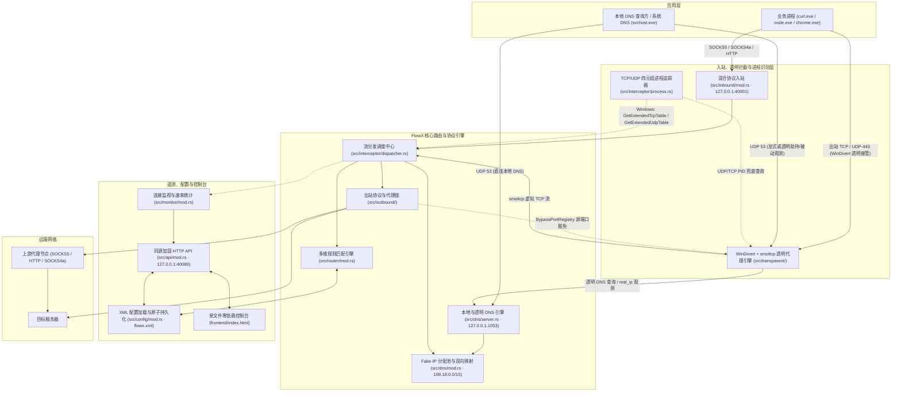

# FlowX 核心架构与工程规范 (FlowX Architecture & Engineering Specification)

FlowX 是一套基于 Rust（Edition 2024）构建的 Windows 进程级透明网络代理与分流引擎。本文档描述当前代码实现的真实系统拓扑、核心模块职责及后续演进路线。

---

## 1. 系统总体架构与拓扑

FlowX 采用分层解耦的设计，包含入站接管与进程追踪、核心路由与协议引擎、配置持久化以及内嵌 Web 控制台四大平面：

---

## 2. 已实现核心模块

### 2.1 混合协议入站与回环防护 (`src/inbound/mod.rs`, `src/interceptor/dispatcher.rs`)
- **单端口多协议嗅探**：在 `127.0.0.1:40001` 上通过首字节自动识别 `SOCKS5`、`SOCKS4 / SOCKS4a`、`HTTP CONNECT` 与 `HTTP` 绝对 URI 明文转发请求；严格将请求头读取上限限制在 `MAX_HTTP_HEADER`（64 KiB，超出或未闭合返回 `431`），拒绝 `HTTP/1.0` 携带 `Transfer-Encoding`、请求路径控制字符（`0x00..=0x1F`/`0x7F`）及 `Host` 头与目标权威端口（明文 HTTP 默认 `80`、`CONNECT` 强制显式端口）不一致等走私畸形报文。
- **有界 HTTP 装帧与双向流闭合**：从代理握手报文中提取真实目标地址与端口，并使用 `find_http_header_end`（增量扫描游标）与 RFC 9110 严格 OWS (`SP` / `HTAB`) 裁剪保持 $O(N)$ 解析与严格的 HTTP `Transfer-Encoding` token 校验；对 `HTTP` 明文转发自动改写为 origin-form，剥离逐跳代理头并强制 `Connection: close`，在出站端按 `Content-Length` / 严格 `Transfer-Encoding: chunked` 状态机完成有界请求体转发并隔离多余前导字节（防止同连接 HTTP 流水线走私），下行 `relay_http_response_downlink` 解析 `1xx` 过渡帧与 HTTP/1.x 响应头/有界响应体（`HEAD`/`204`/`304`、`chunked`、`Content-Length`）并将 `Connection: keep-alive` 改写为 `Connection: close`，响应完毕立即优雅收尾以免忽略 `Connection: close` 的源站挂起至 120s 空闲超时，同时兼容延迟应答与早期 `4xx` 响应。
- **自连回环防护**：拒绝目标指向 FlowX 自身服务端口（`40001` / `40080` / `1053`）与本机接口地址的请求，杜绝自连死循环；连接目标按 `TargetAddr::to_authority_string()` 输出标准 `[ipv6]:port` 权威格式。

### 2.2 进程四元组精确追踪 (`src/interceptor/process.rs`)
- **Windows 原生实现**：调用 `GetExtendedTcpTable` / `GetExtendedUdpTable` 按字节偏移安全读取表项与完整四元组（`local == client && remote == server`）精确检索归属 PID，再通过 `QueryFullProcessImageNameW` 获取完整可执行路径（遇 `ERROR_INSUFFICIENT_BUFFER` 动态倍增缓冲至多 `32768` 宽字符）；`local_interface_ips()` 使用 8 字节对齐的 `Vec<u64>` 缓冲区调用 `GetAdaptersAddresses`。
- **有界缓存与并发隔离**：采用 **10 秒进程身份缓存 (`pid_cache`)**（容量上限 `1024`，绑定进程创建时间校验防 PID 复用且不缓存短命进程 `Unknown`），并通过 `Semaphore(8)`（`200ms` 等待上限）与 `spawn_blocking` 隔离阻塞式系统调用，避免阻塞 Tokio 调度线程。

### 2.3 DNS 拦截、被动观测与 Fake-IP 机制 (`src/dns/mod.rs`, `src/dns/server.rs`)
- **本地与透明 DNS 引擎**：本地服务监听 `127.0.0.1:1053`（`65535` 字节 UDP 接收缓冲，兼容超 `4096B` EDNS0 响应），解析 RFC 1035 域名时计入根标签终止字节 `0x00`（总长度不超过 `255` 字节 / `253` ASCII 字符），豁免瞬时 UDP 错误并通过 `yield_now()` 防自旋；在 `forward_upstream_udp` 区分 `ConnectionReset`（ICMP 不可达）与超时，规范化 `[::ffff:a.b.c.d]:53` 并完整保留 IPv6 `fe80::` 链路本地 `scope_id`。`parse_answer_ips_with_ttl` 采用两阶段解析支持乱序与多跳 CNAME 链、计入链上 CNAME 最小 TTL、将 CNAME 指针解码严格截断至 `rdata_end` 并容忍无关 Answer 属主中的 `*`/`/` 线协议字符。
- **双栈宽限解析与防内网泄露**：`DirectOutbound` 与节点测速采用 `A + AAAA` 并行查询加 `150ms` 次族宽限窗口（避免丢弃 AAAA 的企业/路由器 DNS 拖满 `1.5s~3s` 超时），并在发包前过滤 `169.254/16`、`255.255.255.255`、未带 `scope_id` 的 `fe80::`、Fake-IP 及本机 `self_ports`；当企业/原始分域 DNS 返回权威 `NXDOMAIN` (`RCODE=3`) 时直接向上返回错误，绝不回退泄露至公网 `upstream_dns`。
- **Fake-IP 多 DNS 隔离与独立真实 IP 反查缓存**：`FakeIpPool` 为 `198.18.0.0/15` 维护 `BinaryHeap` $O(\log N)$ 淘汰与每域名多 `orig_dns` 列表（最多 4 个、私网/VPN DNS 优先、读锁快路径防双 DNS 写锁抖动，过期条目绝不复活陈旧 `orig_dns`）；被动 `real_ip -> domain` 缓存使用独立 `RwLock` + $O(\log N)$ 过期堆与读锁先窥探 GC，冲突 IP 退化为 `Ambiguous` 并在冲突窗口结束后自然恢复单域归属。

### 2.4 多维规则路由引擎 (`src/router/mod.rs`, `src/router/parser.rs`)
- **多维条件与 Fail-Closed 保护**：支持应用程序名/路径 Glob 通配符（分号分隔，省略 `.exe` 的简写可匹配 Windows `.exe` 进程）、目标域名通配与 IPv4/IPv6 CIDR 网段、离散端口与端口范围（如 `80; 443; 8000-8080`）；`%ComputerName%` 与兼容别名 `%HOSTNAME%` 在按 `;` 拆词后解析并拦截元字符注入；非法/空白条件生成的 Fail-Closed 空匹配集规则（`Some(vec![])`）在路由与 DNS 预判中均被严格跳过。
- **私有后缀隔离与设计边界**：`is_non_hijackable_local_qname` 保护本机/`localhost`/`.local` (mDNS)/`.arpa`/单标签名；`is_implicit_private_qname` 保护 `.lan`/`.localdomain`/`.home`/`.corp`/`.internal`/`.intranet`/`.ts.net` 不被通配代理规则在 DNS 阶段隐式劫持（显式命中这些后缀的规则仍可生效）。若其解析出的私网/VPN IP（如 `10.0.0.0/8`、`172.16.0.0/12`、`100.64.0.0/10`）未列入 `LocalBypass`，TCP 阶段通配代理规则仍会按 SNI 代理，需按需在规则中添加对应网段或后缀直连规则。
- **动作与动态管理**：支持 `Direct`、`Block`、`Proxy(node_id)` 与 `Chain(chain_id)`；采用自顶向下 First-Match Wins 求值与 CoW 更新，支持在线/离线增删改、启停、排序与干跑路由模拟器 (`simulate`)。

### 2.5 Windows WinDivert 系统级透明代理引擎 (`src/transparent/`)
- **三句柄分层捕获**：Windows 管理员权限下动态加载受信任绝对路径成对的 `WinDivert.dll` / `WinDivert64.sys`，同时打开：(1) `SOCKET` 层 `SNIFF | RECV_ONLY` 句柄维护分片 `SocketPidTable` 与 TCP 关闭旁路失效；(2) 出站 `NETWORK` 层句柄按规则分流 TCP / UDP-53 / UDP-443 QUIC / Fake-IP UDP 与 IPv4/IPv6 分片；(3) 独立入站 `NETWORK` 层内联同步观测句柄（`inbound and !loopback and !impostor and udp.SrcPort == 53`，`flags = 0`，未设 `WINDIVERT_FLAG_FRAGMENTS` 由 WinDivert 内核自动重组完整入站 IP 包）先将 `InspectDns` 应答中的 `real_ip -> domain` 落盘后再无条件原样重注入 OS（出站原包直接 `emit_passthrough`，消除 DNS 应答与 TCP SYN 竞态，同时完整保留 OS 原生接口、VPN 绑定、超 `4096B` EDNS0 与 `fe80::` `scope_id`）。
- **有界 IPv4/IPv6 分片重组与卸载兼容 (`fragment.rs`, `dns_hijack.rs`, `netstack.rs`)**：先校验合法性/重叠后再执行容量驱逐，严格按 RFC 6946 隔离 IPv6 原子分片，完整支持 `0/43/51/60/135(Mobility)/139(HIP)/140(SHIM6)` 最多 8 层 IPv6 扩展头、post-Fragment 非 TCP/UDP (`58/50/59`) 逐片透传，以及 Windows NDIS LSO / UDP `length == 0` 卸载报文解析。
- **用户态 TCP 协议栈与权威首包嗅探 (`netstack.rs`, `sniffer.rs`, `bypass.rs`)**：单所有权 `smoltcp` 引擎负责四元组劫持、半关闭与非优雅取消/断链槽位回收（`poll_shutdown` 仅在写缓冲排空且发 FIN 后置位 `graceful_shutdown`）；`BypassPortRegistry` 按 TCP/UDP 与 IPv4/IPv6 四表隔离登记 FlowX 自身出站源端口并保证 socket 先于守卫析构；`sniffer.rs` 支持跨多条 TLS Record 拆分的 `ClientHello` SNI 与 HTTP `Host` 严格主机名嗅探，在 `NeedsDomainSniff` 及 `Immediate(Proxy | Chain)`（覆盖 `8444`/`9443`/`2083`/`3000` 等非标准端口，豁免已知服务端先发端口）下优先提取权威域名，且异步确定 `Immediate(Direct | Block)` 后绝不被 SYN 期过期嗅探标记拖慢。
- **UAC 平滑提权与配置隔离**：`POST /api/transparent/elevate` 使用独立无锁原子闸门并在 `spawn_blocking` 内持有 `ElevateFlagResetGuard` 与 `shutdown_tx`（与 `Ctrl+C` 的 `503 ERR_SERVER_SHUTTING_DOWN` 明确区分），通过 `ShellExecuteW("runas")` 以 `--transparent --replace-pid <old_pid>` 接管端口；`--transparent` / `--no-transparent` 仅覆写本次运行时状态，不污染磁盘 `<TransparentProxy enabled="...">`；`flowx transparent status | enable | disable | config | doctor` 均统一遵循 `--api` / `$FLOWX_API` / `--offline` 语义。

### 2.6 多协议出站与代理链 (`src/outbound/`)
- **协议与上游 DNS 防护**：`DirectOutbound`、`Socks5Client`（RFC 1928/1929 账密认证）、`HttpConnectClient`（Basic 认证、`username` 禁冒号、CRLF 与非法目标字符校验）与 `Socks4Client`（含 SOCKS4a 域名扩展）统一通过上游 UDP DNS 解析并经 `validate_direct_ips` 过滤 Fake-IP（`198.18.0.0/15`）、回环及本机接口上的 FlowX 服务端口，支持多 IP 有限故障转移。
- **多跳代理链 (`ProxyChain`)**：支持在已有隧道流上递归握手串联多跳节点，在构建期与中间跳拨号期统一执行循环检测、`local_interface_ips()`/`self_ports`/Fake-IP 防护与全链路超时控制。
- **流量监视中继**：全双工对拷采用双向同时静默 120 秒空闲超时与半关闭持续传输支持（内部统一超时看门狗），并具备实时手动熔断切断通知。

### 2.7 配置持久化、双栖 CLI 与同源加固控制台 (`src/config/mod.rs`, `src/api/mod.rs`, `src/cli.rs`, `src/monitor/mod.rs`, `src/i18n/mod.rs`, `frontend/index.html`)
- **XML 配置 (`flowx.xml`) 与历史兼容降级**：支持通过 `--config <路径>` 或环境变量 `FLOWX_CONFIG`（空白自动回退 `./flowx.xml`）指定配置文件，`validate_xml_root_profile` 强校验未加命名空间前缀的精确 `<Profile>` 根元素并扫描至 `EOF` 拒绝多根元素或尾随非空白内容；`load_or_init` 在 `save_lock` 下双重检查避免并发初始化覆盖，并通过临时文件写盘、`sync_all` 与原子重命名落盘；对 `HTTP`/`SOCKS5` 节点强制凭据成对约束（加载遗留配置若出现孤立 `<Username>` 且无 `<Password>` 会先执行 `warn` 告警并降级清空用户名，随后再校验 `HTTP` 用户名冒号 `:` 与控制字符/长度上限，确保旧配置可平稳升级启动），`SOCKS4` 仅允许可选 `UserID` 并拒绝任何 `<Password>` 标签，节点 `Name`/`Username`/`Password` 均禁止控制字符或超过 `255` 字节，并禁止保存指向 Fake-IP（含 `[::ffff:198.18.0.x]`）或自身服务端口的节点。
- **API 安全加固、错误状态矩阵与原子凭据一致性**：强制 `Host` 回环白名单（防 DNS Rebinding）与 `Origin` / `Referer` / `Sec-Fetch-Site` 同源校验（防 CSRF），`Accept-Language` 严格校验 `0.0..=1.0` 且有限 (`is_finite`) 的 `q` 权重；完整响应状态码涵盖 `204 No Content`（`OPTIONS`）、`400 Bad Request`、`403 Forbidden`、`404 Not Found`、`408 Request Timeout`、`409 Conflict`（节点被引用禁止删除 `ERR_NODE_IN_USE`）、`413 Payload Too Large`、`415 Unsupported Media Type`、`500 Internal Server Error`（写盘失败或超 `5s` 持久化超时返回 `ERR_CONFIG_PERSIST_FAILED` 并回滚内存状态）、`501 Not Implemented`（不支持的 `Transfer-Encoding`）与 `503 Service Unavailable`。全量替换 `PUT` 下 `keep_password` 缺省为 `false`（复用原密码需显式传 `keep_password: true`），部分更新 `PATCH` 下缺省为 `true`；在 `PUT` 与 `PATCH` 下严禁 `keep_password: true` 与非空 `password` 同传、`clear_username: true` 与非空 `username` 同传 (`ERR_CONFLICTING_USERNAME_OPTIONS`)、`username: None` 与 `clear_password: false`（当原节点存在密码且未传新密码，返回 `ERR_CONFLICTING_PASSWORD_OPTIONS`）以及 `SOCKS4` 携带任何 `password` 字段（含空串，返回 `ERR_SOCKS4_PASSWORD_UNSUPPORTED`），而沿用原用户名配 `clear_password: true` 均会一并清空用户名与密码（若变更用户名则拒绝）。配置写操作受限于 `mutation_semaphore`（16 并发）与持久化超时预算（`CONFIG_PERSIST_TIMEOUT`），并在内存与磁盘提交完成后提前释放写锁再发响应，确保慢盘阻塞不会耗尽全局 `conn_limit` (128) 而饿死 `/api/health` 或 `/api/connections/kill`。`ActiveConnection::cancelled()` 与 `InFlightTracker::wait_zero()` 均使用 `tokio::pin! + enable()` 在检查原子状态前先注册唤醒，配合 `JoinSet` 杜绝停机排空与断链丢唤醒。
- **双栖 CLI 控制子命令 (`src/cli.rs`)**：支持 `flowx status | transparent | node | rule | default | sim | conn`、`--` 选项终止符与 `--json` 结构化错误/输出（按 `FLOWX_LANG -> LC_ALL -> LC_MESSAGES -> LANG` 探测环境语言并与请求头 `Accept-Language` 同步），HTTP 客户端支持分块传输 (`Transfer-Encoding: chunked`) 解码、CL/TE 冲突检测、`64 KiB` 头/`16 MiB` 响应体上限及 `2xx` 空体拒收；只读离线命令绝不新建缺失配置，`node ping` 不可达或 `conn kill` 返回 `killed=false` 在完整输出 JSON/文本并刷新 stdout 后以非零退出码 (`1`) 退出；配套 Agent 技能定义（`skills/flowx/SKILL.md`）与模板 `flowx.example.xml`。
- **内嵌现代 Web 控制台**：单文件零外部依赖 HTML/CSS/JS（`include_str!` 打包，支持中英双语、深浅主题与模态框实时重译），提供无竞态轮询控制（单调序列令牌防陈旧响应覆盖与暂停定时器清理）、60 秒实时吞吐 SVG 折线图、连接过滤/IPv6 `[host]:port` 格式化显示与切断、节点成对凭证表单与并发保护测速、规则新增/编辑/启停/排序、默认兜底动作切换以及交互式路由规则命中模拟器。

---

## 3. 演进路线（规划中）

- **代理链可视化编排**：在 Web 控制台中开放多跳 `ProxyChain` 的创建与管理界面。
- **桌面壳包装**：可选基于 Tauri 封装为独立 Windows 桌面托盘应用。
