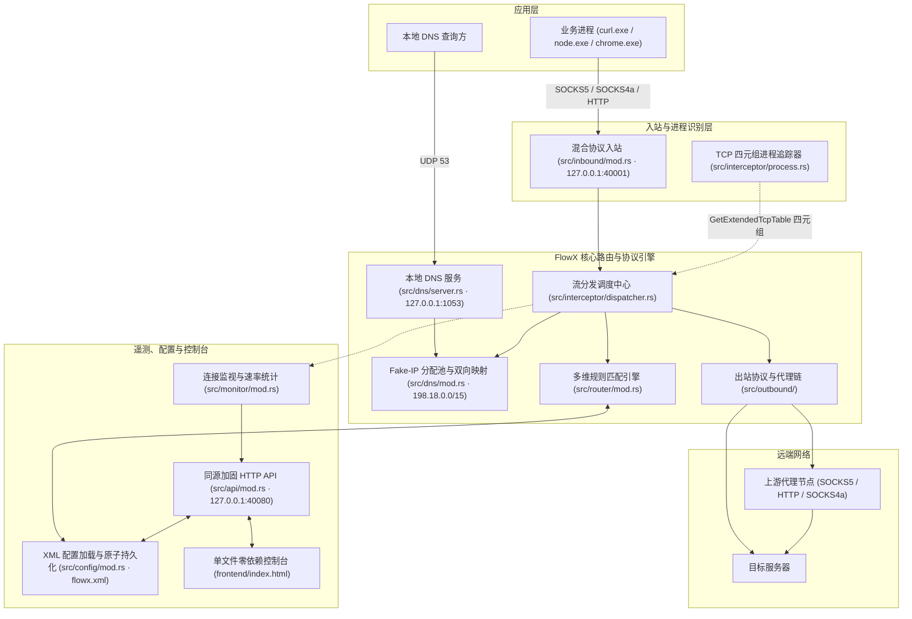

# FlowX 核心架构与工程规范 (FlowX Architecture & Engineering Specification)

FlowX 是一套基于 Rust（Edition 2024）构建的进程级透明网络代理与分流引擎。本文档描述当前代码实现的真实系统拓扑、核心模块职责及后续演进路线。

---

## 1. 系统总体架构与拓扑

FlowX 采用分层解耦的设计，包含入站接管与进程追踪、核心路由与协议引擎、配置持久化以及内嵌 Web 控制台四大平面：

---

## 2. 已实现核心模块

### 2.1 混合协议入站与回环防护 (`src/inbound/mod.rs`, `src/interceptor/dispatcher.rs`)
- **单端口多协议嗅探**：在 `127.0.0.1:40001` 上通过首字节自动识别 `SOCKS5`、`SOCKS4 / SOCKS4a`、`HTTP CONNECT` 与 `HTTP` 绝对 URI 明文转发请求。
- **真实目标解析与安全改写**：从代理握手报文中提取真实目标地址与端口；对 `HTTP` 明文转发自动改写为 origin-form，剥离逐跳代理头并强制 `Connection: close`，防止 keep-alive 连接串目标。
- **自连回环防护**：拒绝目标指向 FlowX 自身服务端口（`40001` / `40080` / `1053`）的请求，杜绝自连死循环。

### 2.2 进程四元组精确追踪 (`src/interceptor/process.rs`)
- **四元组匹配**：在 Windows 上调用 `GetExtendedTcpTable` 按完整四元组（`local == client && remote == server`）精确检索归属 PID，再通过 `QueryFullProcessImageNameW` 获取完整可执行路径。
- **二级 TTL 缓存**：结合 1 秒连接缓存与 10 秒 PID 路径缓存，并通过 `spawn_blocking` 隔离 Win32 阻塞调用，避免阻塞 Tokio 调度线程。

### 2.3 DNS 拦截与 Fake-IP 机制 (`src/dns/mod.rs`, `src/dns/server.rs`)
- **本地 DNS 服务**：监听 `127.0.0.1:1053`，默认拦截阻断 `AAAA`（Type 28）、`SVCB`（Type 64）与 `HTTPS`（Type 65）查询并回复空 NOERROR 应答，防止 IPv6 泄漏与 `ipv4hint` 绕过 Fake-IP；其余查询通过独立内部事务 ID 映射器并校源自上游 IP 后，复用 UDP 套接字转发至 `223.5.5.5:53`。
- **Fake-IP 滑动续期**：为 `A` 查询从 `198.18.0.0/15` 分配虚拟 IP 并维护双向映射；在 `allocate()` / `restore()` 命中活跃域名时自动滑动续期 TTL，防止活跃会话中途丢失域名映射。

### 2.4 多维规则路由引擎 (`src/router/mod.rs`, `src/router/parser.rs`)
- **多维条件**：支持应用程序名/路径 Glob 通配符（分号分隔）、目标域名通配与 IPv4/IPv6 CIDR 网段、离散端口与端口范围（如 `80; 443; 8000-8080`）。
- **动作与顺序**：支持 `Direct`、`Block`、`Proxy(node_id)` 与 `Chain(chain_id)`；采用自顶向下 First-Match Wins 求值与不可变快照 CoW 更新，末尾提供可动态热更新的兜底默认动作（`set_default_action`）。
- **动态管理与干跑诊断**：支持运行时新增、删除、原地更新（`update_rule`，保留规则 ID、启用状态与优先级顺序）、启停开关（`toggle_rule`）、优先级调整（`move_rule`：`up` / `down` / `top` / `bottom`）以及干跑路由模拟器（`simulate`，输出命中规则与逐条未命中原因轨迹）。

### 2.5 多协议出站与代理链 (`src/outbound/`)
- **协议支持**：`DirectOutbound`（10 秒建连超时保护）、`Socks5Client`（RFC 1928/1929 账密认证）、`HttpConnectClient`（Basic 认证与 CRLF 注入校验）、`Socks4Client`（含 SOCKS4a 域名扩展）。
- **多跳代理链 (`ProxyChain`)**：支持在已有隧道流上递归握手串联多跳节点，具备统一地址规范校验、未指定地址/大小写不敏感循环检测与单跳/全链路超时控制。
- **流量监视中继**：全双工对拷采用双向同时静默 120 秒空闲超时与半关闭持续传输支持，并具备实时手动熔断切断通知。

### 2.6 配置持久化、双栖 CLI 与同源加固控制台 (`src/config/mod.rs`, `src/api/mod.rs`, `src/cli.rs`, `frontend/index.html`)
- **XML 配置 (`flowx.xml`)**：支持通过 `--config <路径>` 或环境变量 `FLOWX_CONFIG` 指定配置文件，缺省自动生成默认 `flowx.xml`；API 或 CLI 修改节点、规则与默认兜底动作后串行化原子写回磁盘（临时文件写入 + `rename` 替换）。
- **API 安全加固与完备控制面**：移除通配 CORS，强制 `Host` 回环白名单（防 DNS Rebinding）与 `Origin` / `Referer` / `Sec-Fetch-Site` 同源校验（防 CSRF）；提供节点增删改与按 ID 测速（`GET/POST/PUT/DELETE /api/nodes`、`POST /api/nodes/ping`）、规则增删改与排序启停（`GET/POST/PUT/DELETE /api/rules`、`POST /api/rules/toggle`、`POST /api/rules/move`）、默认兜底切换（`POST /api/rules/default`）及路由命中模拟（`POST /api/rules/simulate`）。
- **双栖 CLI 控制子命令 (`src/cli.rs`)**：支持 `flowx status | node | rule | default | sim | conn` 及 `--json` 机器可读输出，在线时自动调用本地 HTTP API，离线时直接安全读写 `flowx.xml`，并配套内置 Agent 技能定义（`skills/flowx/SKILL.md`）。
- **内嵌现代 Web 控制台**：单文件零外部依赖 HTML/CSS/JS（`include_str!` 打包，支持中英双语与深浅主题），提供 60 秒实时吞吐 SVG 折线图、连接过滤与切断、节点新增/编辑/批量测速、规则新增/编辑/启停/排序、默认兜底动作切换以及交互式路由规则命中模拟器。

---

## 3. 演进路线（规划中）

- **驱动级透明接管**：集成 `wintun.dll` 或 WinDivert，实现无需业务进程显式配置代理端口的系统级透明流量重定向与 UDP 转发。
- **代理链可视化编排**：在 Web 控制台中开放多跳 `ProxyChain` 的创建与管理界面。
- **桌面壳包装**：可选基于 Tauri 封装为独立桌面托盘应用。
