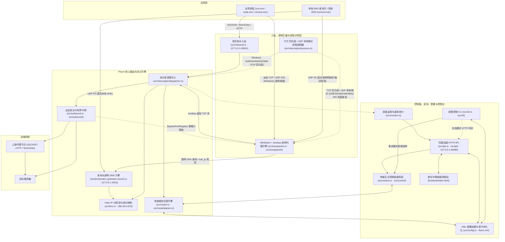

# FlowX 核心架构与工程规范 (FlowX Architecture & Engineering Specification)

FlowX 是一套基于 Rust（Edition 2024）构建的 Windows 进程级透明网络代理与分流引擎。本文档描述当前代码实现的真实系统拓扑、目录布局、核心模块职责及后续演进路线。

---

## 1. 系统总体架构与拓扑

FlowX 采用分层解耦与现代 Rust 2024 库/二进制分离布局（`src/lib.rs` + `src/main.rs`，`src/` 下零 `mod.rs`），包含入站接管与进程追踪、核心路由与协议引擎、传输无关控制面服务层以及遥测/配置/控制台四大平面：



---

## 2. 源码目录与模块边界

FlowX 采用现代 Rust（2018+/2024）扁平模块布局：`src/lib.rs` 导出全部库模块，`src/main.rs` 仅承载二进制入口、信号处理与运行时装配；`src/` 目录下不包含任何 `mod.rs` 文件；跨模块集成测试独立沉淀于顶层 `tests/` 目录。

```text
src/
├── lib.rs                  # 库入口与 Windows 平台编译门禁
├── main.rs                 # 二进制入口（serve 装配、替换旧实例、Windows 控制台优雅停机）
├── config.rs               # XML Schema 校验与原子持久化 (flowx.xml)
├── inbound.rs              # SOCKS5 / SOCKS4a / HTTP CONNECT / 明文 HTTP 入站解析
├── monitor.rs              # 活跃连接注册表、速率采样与 InFlightTracker 停机排空
├── i18n.rs                 # 中英双语词典与 Accept-Language / 环境变量协商
├── control.rs              # 传输无关控制面错误模型与公共 DTO 导出
├── control/
│   ├── node.rs             # 节点列表、增删改、成对凭据一致性校验与并发安全 Ping
│   ├── rule.rs             # 规则增删改、启停、排序与动作目标校验
│   ├── routing.rs          # 默认兜底动作、路由干跑模拟与系统状态快照构造
│   └── transparent.rs      # 透明代理配置拼装与错误码分类
├── api.rs                  # ApiServer 生命周期、并发闸门与白盒单元测试
├── api/
│   ├── http.rs             # HTTP 帧读取、防重绑定 Host 与同源 CSRF 校验
│   ├── routes.rs           # 路由分发、写锁序列化与异步持久化超时回滚
│   ├── system.rs           # Dashboard、健康检查、系统信息与活跃连接接口
│   ├── nodes.rs            # /api/nodes 与 /api/nodes/ping 处理器
│   ├── rules.rs            # /api/rules* 与 /api/rules/simulate 处理器
│   └── transparent.rs      # /api/transparent/{status,toggle,config,elevate} 处理器
├── cli.rs                  # CLI 顶层分发、公开入口重导出与内部解析器单元测试
├── cli/
│   ├── args.rs             # 全局/子命令参数解析、--api 归一化与帮助文本
│   ├── http_client.rs      # 本地 API 客户端（chunked 解码、限流上限与 JSON 错误格式化）
│   ├── bridge.rs           # 离线配置加载与 ControlError -> CLI 退出码适配
│   ├── status_sim.rs       # status / default / sim 子命令
│   ├── node.rs             # node list|add|update|remove|ping 子命令
│   ├── rule.rs             # rule list|add|update|toggle|move|remove 子命令
│   ├── conn.rs             # conn list|kill 子命令与过滤器
│   └── transparent.rs      # transparent status|enable|disable|config|doctor|elevate 子命令
├── dns.rs                  # Fake-IP 分配池 (198.18.0.0/15)、多 orig_dns 隔离与 real_ip 反查缓存
├── dns/
│   ├── codec.rs            # RFC 1035 查询/应答编解码、CNAME 链解析与被动响应观测
│   ├── upstream.rs         # 上游 UDP 转发、双栈 150ms 宽限解析与权威 NXDOMAIN 识别
│   └── server.rs           # 本地 UDP DNS 监听器与透明劫持/被动观测入口
├── router.rs               # 多维规则求值引擎、私有后缀保护与 DNS/TCP 预判策略
├── router/
│   └── parser.rs           # 应用 Glob、域名通配、IPv4/IPv6 CIDR 与端口范围解析器
├── interceptor.rs          # 入站流分发与进程追踪模块导出
├── interceptor/
│   ├── dispatcher.rs       # 显式与透明 TCP 流调度、首包 SNI/Host 嗅探与出站拨号
│   └── process.rs          # Windows TCP 四元组 / UDP 本地端点 PID 追踪与有界身份缓存
├── outbound.rs             # RelayStream 抽象、TargetAddr 解析与本机接口回环防护
├── outbound/
│   ├── relay.rs            # 全双工透明流中继与双向静默超时看门狗
│   ├── http_relay.rs       # 明文 HTTP 有界请求/响应体状态机与反流水线走私中继
│   ├── bypass.rs           # BypassPortRegistry 四表源端口豁免与受护拨号/绑定
│   ├── direct.rs           # 直连出站（上游 DNS 解析、Fake-IP/回环防护与多 IP 故障转移）
│   ├── socks5.rs           # SOCKS5 出站客户端（RFC 1928/1929）
│   ├── http.rs             # HTTP CONNECT 出站客户端（Basic 认证与头部安全校验）
│   ├── socks4.rs           # SOCKS4 / SOCKS4a 出站客户端
│   └── chain.rs            # 多跳 ProxyChain 递归隧道握手与环路防护
├── transparent.rs          # TransparentSettings、驱动探测快照与 TransparentManager 生命周期管理
└── transparent/
    ├── platform.rs         # Windows 管理员/完整性级别检测、System32 安全加载、DNS 刷新与 UAC 提权
    ├── runtime.rs          # WinDivert 三句柄打开、四工作线程调度与原子启动/停机回收
    ├── netstack.rs         # 单所有权 smoltcp 用户态 TCP 协议栈引擎与会话状态机
    ├── netstack/
    │   ├── packet.rs       # IPv4/IPv6 + LSO TCP 报文解析、切片入队与合成 RST 构造
    │   └── bridge.rs       # NetstackSignal 唤醒信箱、SmoltcpStream 异步双工桥与虚拟 L3 设备
    ├── fragment.rs         # 有界 IPv4/IPv6 分片重组器与 RFC 6946 原子分片处理
    ├── dns_hijack.rs       # UDP/53 与 UDP/443 分流裁决及 PendingInspectDnsTable 观测表
    ├── sniffer.rs          # 跨多 Record TLS ClientHello SNI 与 HTTP Host 首包嗅探器
    ├── pid_table.rs        # 分片 SocketPidTable 缓存与滑窗 TTL 管理
    └── windivert_ffi.rs    # WinDivert 动态加载、同目录配对校验与 C ABI 封装

tests/
├── common/mod.rs           # 集成测试共享夹具（ApiServer 启动与原始 HTTP 辅助函数）
├── api_integration.rs      # HTTP API 端到端安全、CRUD、持久化与透明代理配置集成测试
├── cli_integration.rs      # CLI 离线/在线双模子命令、参数校验与 JSON 错误集成测试
└── dispatcher_integration.rs # 显式 SOCKS5/HTTP 入站与透明流 SNI 嗅探调度集成测试
```

---

## 3. 已实现核心模块

### 3.1 混合协议入站与回环防护 (`src/inbound.rs`, `src/interceptor/dispatcher.rs`)
- **单端口多协议嗅探**：在 `127.0.0.1:40001` 上通过首字节自动识别 `SOCKS5`、`SOCKS4 / SOCKS4a`、`HTTP CONNECT` 与 `HTTP` 绝对 URI 明文转发请求；严格将请求头读取上限限制在 `MAX_HTTP_HEADER`（64 KiB，超出或未闭合返回 `431`），拒绝 `HTTP/1.0` 携带 `Transfer-Encoding`、请求路径控制字符（`0x00..=0x1F`/`0x7F`）及 `Host` 头与目标权威端口（明文 HTTP 默认 `80`、`CONNECT` 强制显式端口）不一致等走私畸形报文。
- **有界 HTTP 装帧与双向流闭合**：从代理握手报文中提取真实目标地址与端口，并使用 `find_http_header_end`（增量扫描游标）与 RFC 9110 严格 OWS (`SP` / `HTAB`) 裁剪保持 $O(N)$ 解析与严格的 HTTP `Transfer-Encoding` token 校验；对 `HTTP` 明文转发自动改写为 origin-form，剥离逐跳代理头并强制 `Connection: close`，在出站端（`src/outbound/http_relay.rs`）按 `Content-Length` / 严格 `Transfer-Encoding: chunked` 状态机完成有界请求体转发并隔离多余前导字节（防止同连接 HTTP 流水线走私），下行 `relay_http_response_downlink` 解析 `1xx` 过渡帧与 HTTP/1.x 响应头/有界响应体（`HEAD`/`204`/`304`、`chunked`、`Content-Length`）并将 `Connection: keep-alive` 改写为 `Connection: close`，响应完毕立即优雅收尾以免忽略 `Connection: close` 的源站挂起至 120s 空闲超时，同时兼容延迟应答与早期 `4xx` 响应。
- **自连回环防护**：拒绝目标指向 FlowX 自身服务端口（`40001` / `40080` / `1053`）与本机接口地址的请求，杜绝自连死循环；连接目标按 `TargetAddr::to_authority_string()` 输出标准 `[ipv6]:port` 权威格式。

### 3.2 进程精确追踪 (`src/interceptor/process.rs`)
- **Windows 原生实现**：TCP 侧调用 `GetExtendedTcpTable` 按字节偏移安全读取表项与完整四元组（`local == client && remote == server`）精确检索归属 PID；UDP 侧调用 `GetExtendedUdpTable` 按本地端点二元组（`local_ip + local_port`，含通配绑定 `0.0.0.0`/`::` 兜底匹配）检索归属 PID；随后通过 `QueryFullProcessImageNameW` 获取完整可执行路径（遇 `ERROR_INSUFFICIENT_BUFFER` 动态倍增缓冲至多 `32768` 宽字符）。
- **有界缓存与并发隔离**：采用 **10 秒进程身份缓存 (`pid_cache`)**（容量上限 `1024`，绑定进程创建时间校验防 PID 复用且不缓存短命进程 `Unknown`），并通过 `Semaphore(8)`（`200ms` 等待上限）与 `spawn_blocking` 隔离阻塞式系统调用，避免阻塞 Tokio 调度线程。

### 3.3 DNS 拦截、被动观测与 Fake-IP 机制 (`src/dns.rs`, `src/dns/{codec,upstream,server}.rs`)
- **本地与透明 DNS 引擎**：本地服务监听 `127.0.0.1:1053`（`65535` 字节 UDP 接收缓冲，兼容超 `4096B` EDNS0 响应），`src/dns/codec.rs` 解析 RFC 1035 域名时计入根标签终止字节 `0x00`（总长度不超过 `255` 字节 / `253` ASCII 字符），`src/dns/server.rs` 豁免瞬时 UDP 错误并通过 `yield_now()` 防自旋；`src/dns/upstream.rs` 的 `forward_upstream_udp` 区分 `ConnectionReset`（ICMP 不可达）与超时，规范化 `[::ffff:a.b.c.d]:53` 并完整保留 IPv6 `fe80::` 链路本地 `scope_id`。`parse_answer_ips_with_ttl` 采用两阶段解析支持乱序与多跳 CNAME 链、计入链上 CNAME 最小 TTL、将 CNAME 指针解码严格截断至 `rdata_end` 并容忍无关 Answer 属主中的 `*`/`/` 线协议字符。
- **双栈宽限解析与防内网泄露**：`DirectOutbound` 与节点测速采用 `A + AAAA` 并行查询加 `150ms` 次族宽限窗口（避免丢弃 AAAA 的企业/路由器 DNS 拖满 `1.5s~3s` 超时），并在发包前过滤 `169.254/16`、`255.255.255.255`、未带 `scope_id` 的 `fe80::`、Fake-IP 及本机 `self_ports`；当企业/原始分域 DNS 返回权威 `NXDOMAIN` (`RCODE=3`) 时直接向上返回错误，绝不回退泄露至公网 `upstream_dns`。
- **Fake-IP 多 DNS 隔离与独立真实 IP 反查缓存**：`FakeIpPool` 为 `198.18.0.0/15` 维护 `BinaryHeap` $O(\log N)$ 淘汰与每域名多 `orig_dns` 列表（最多 4 个、私网/VPN DNS 优先、读锁快路径防双 DNS 写锁抖动，过期条目绝不复活陈旧 `orig_dns`）；被动 `real_ip -> domain` 缓存使用独立 `RwLock` + $O(\log N)$ 过期堆与读锁先窥探 GC，冲突 IP 退化为 `Ambiguous` 并在冲突窗口结束后自然恢复单域归属。

### 3.4 多维规则路由引擎 (`src/router.rs`, `src/router/parser.rs`)
- **多维条件与 Fail-Closed 保护**：支持应用程序名/路径 Glob 通配符（分号分隔，省略 `.exe` 的简写可匹配 Windows `.exe` 进程）、目标域名通配与 IPv4/IPv6 CIDR 网段、离散端口与端口范围（如 `80; 443; 8000-8080`）；`%ComputerName%` 与兼容别名 `%HOSTNAME%` 在按 `;` 拆词后解析并拦截元字符注入；非法/空白条件生成的 Fail-Closed 空匹配集规则（`Some(vec![])`）在路由与 DNS 预判中均被严格跳过。
- **私有后缀隔离与设计边界**：`is_non_hijackable_local_qname` 保护本机/`localhost`/`.local` (mDNS)/`.arpa`/单标签名；`is_implicit_private_qname` 保护 `.lan`/`.localdomain`/`.home`/`.corp`/`.internal`/`.intranet`/`.ts.net` 不被通配代理规则在 DNS 阶段隐式劫持（显式命中这些后缀的规则仍可生效）。若其解析出的私网/VPN IP（如 `10.0.0.0/8`、`172.16.0.0/12`、`100.64.0.0/10`）未列入 `LocalBypass`，TCP 阶段通配代理规则仍会按 SNI 代理，需按需在规则中添加对应网段或后缀直连规则。
- **动作与动态管理**：支持 `Direct`、`Block`、`Proxy(node_id)` 与 `Chain(chain_id)`；采用自顶向下 First-Match Wins 求值与 CoW 更新，支持在线/离线增删改、启停、排序与干跑路由模拟器 (`simulate`)。

### 3.5 Windows WinDivert 系统级透明代理引擎 (`src/transparent.rs`, `src/transparent/`)
- **三句柄分层捕获 (`runtime.rs`, `windivert_ffi.rs`, `pid_table.rs`)**：Windows 管理员权限下动态加载受信任绝对路径成对的 `WinDivert.dll` / `WinDivert64.sys`，同时打开：(1) `SOCKET` 层 `SNIFF | RECV_ONLY` 句柄维护分片 `SocketPidTable` 与 TCP 关闭旁路失效；(2) 出站 `NETWORK` 层句柄按规则分流 TCP / UDP-53 / UDP-443 QUIC / Fake-IP UDP 与 IPv4/IPv6 分片；(3) 独立入站 `NETWORK` 层内联同步观测句柄（`inbound and !loopback and !impostor and udp.SrcPort == 53`，`flags = 0`，未设 `WINDIVERT_FLAG_FRAGMENTS` 由 WinDivert 内核自动重组完整入站 IP 包）先将 `InspectDns` 应答中的 `real_ip -> domain` 落盘后再无条件原样重注入 OS（出站原包直接 `emit_passthrough`，消除 DNS 应答与 TCP SYN 竞态，同时完整保留 OS 原生接口、VPN 绑定、超 `4096B` EDNS0 与 `fe80::` `scope_id`）。
- **有界 IPv4/IPv6 分片重组与卸载兼容 (`fragment.rs`, `dns_hijack.rs`, `netstack/packet.rs`)**：先校验合法性/重叠后再执行容量驱逐，严格按 RFC 6946 隔离 IPv6 原子分片，完整支持 `0/43/51/60/135(Mobility)/139(HIP)/140(SHIM6)` 最多 8 层 IPv6 扩展头、post-Fragment 非 TCP/UDP (`58/50/59`) 逐片透传，以及 Windows NDIS LSO / UDP `length == 0` 卸载报文解析。
- **用户态 TCP 协议栈与权威首包嗅探 (`netstack.rs`, `netstack/{packet,bridge}.rs`, `sniffer.rs`, `src/outbound/bypass.rs`)**：单所有权 `smoltcp` 引擎负责四元组劫持、半关闭与非优雅取消/断链槽位回收（`poll_shutdown` 仅在写缓冲排空且发 FIN 后置位 `graceful_shutdown`）；`BypassPortRegistry` 按 TCP/UDP 与 IPv4/IPv6 四表隔离登记 FlowX 自身出站源端口并保证 socket 先于守卫析构；`sniffer.rs` 支持跨多条 TLS Record 拆分的 `ClientHello` SNI 与 HTTP `Host` 严格主机名嗅探，在 `NeedsDomainSniff` 及 `Immediate(Proxy | Chain)`（覆盖 `8444`/`9443`/`2083`/`3000` 等非标准端口，豁免已知服务端先发端口）下优先提取权威域名，且异步确定 `Immediate(Direct | Block)` 后绝不被 SYN 期过期嗅探标记拖慢。
- **UAC 平滑提权与配置隔离 (`platform.rs`, `api/transparent.rs`)**：`POST /api/transparent/elevate` 使用独立无锁原子闸门并在 `spawn_blocking` 内持有 `ElevateFlagResetGuard` 与 `shutdown_tx`（与 `Ctrl+C` 的 `503 ERR_SERVER_SHUTTING_DOWN` 明确区分），通过 `ShellExecuteW("runas")` 以 `--transparent --replace-pid <old_pid>` 接管端口；`--transparent` / `--no-transparent` 仅覆写本次运行时状态，不污染磁盘 `<TransparentProxy enabled="...">`；`flowx transparent status | enable | disable | config | doctor` 均统一遵循 `--api` / `$FLOWX_API` / `--offline` 语义。

### 3.6 多协议出站与代理链 (`src/outbound.rs`, `src/outbound/`)
- **协议与上游 DNS 防护**：`DirectOutbound`、`Socks5Client`（RFC 1928/1929 账密认证）、`HttpConnectClient`（Basic 认证、`username` 禁冒号、CRLF 与非法目标字符校验）与 `Socks4Client`（含 SOCKS4a 域名扩展）统一通过上游 UDP DNS 解析并经 `validate_direct_ips` 过滤 Fake-IP（`198.18.0.0/15`）、回环及本机接口上的 FlowX 服务端口，支持多 IP 有限故障转移；`src/outbound.rs` 中的 `local_interface_ips()` 使用 8 字节对齐的 `Vec<u64>` 缓冲区调用 `GetAdaptersAddresses`（同时纳入 `IpDadStatePreferred` 与 `IpDadStateDeprecated` 接口地址）。
- **多跳代理链 (`chain.rs`)**：支持在已有隧道流上递归握手串联多跳节点，在构建期与中间跳拨号期统一执行循环检测、`local_interface_ips()`/`self_ports`/Fake-IP 防护与全链路超时控制。
- **流量监视中继 (`relay.rs`, `http_relay.rs`)**：全双工对拷采用双向同时静默 120 秒空闲超时与半关闭持续传输支持（内部统一超时看门狗），并具备实时手动熔断切断通知。

### 3.7 控制面解耦、配置持久化、双栖 CLI 与同源加固控制台 (`src/control/`, `src/config.rs`, `src/api/`, `src/cli/`, `src/monitor.rs`, `src/i18n.rs`, `frontend/index.html`)
- **传输无关控制面 (`src/control.rs`, `src/control/{node,rule,routing,transparent}.rs`)**：封装节点 CRUD/测速、规则 CRUD/启停/排序、默认兜底动作、路由干跑模拟及透明代理配置更新等核心领域业务与统一错误模型 (`ControlError`)；`src/api/` 与 `src/cli/` 共享该服务层实现，`src/cli/` 生产代码与单元测试均零依赖 `crate::api`。
- **XML 配置 (`src/config.rs`, `flowx.xml`) 与历史兼容降级**：支持通过 `--config <路径>` 或环境变量 `FLOWX_CONFIG`（空白自动回退 `./flowx.xml`）指定配置文件，`validate_xml_root_profile` 强校验未加命名空间前缀的精确 `<Profile>` 根元素并扫描至 `EOF` 拒绝多根元素或尾随非空白内容；`load_or_init` 在 `save_lock` 下双重检查避免并发初始化覆盖，并通过临时文件写盘、`sync_all` 与原子重命名落盘；对 `HTTP`/`SOCKS5` 节点强制凭据成对约束（加载遗留配置若出现孤立 `<Username>` 且无 `<Password>` 会先执行 `warn` 告警并降级清空用户名，随后再校验 `HTTP` 用户名冒号 `:` 与控制字符/长度上限，确保旧配置可平稳升级启动），`SOCKS4` 仅允许可选 `UserID` 并拒绝任何 `<Password>` 标签，节点 `Name`/`Username`/`Password` 均禁止控制字符或超过 `255` 字节，并禁止保存指向 Fake-IP（含 `[::ffff:198.18.0.x]`）或自身服务端口的节点。
- **API 安全加固、错误状态矩阵与原子凭据一致性 (`src/api.rs`, `src/api/{http,routes,system,nodes,rules,transparent}.rs`)**：强制 `Host` 回环白名单（防 DNS Rebinding）与 `Origin` / `Referer` / `Sec-Fetch-Site` 同源校验（防 CSRF），`Accept-Language` 严格校验 `0.0..=1.0` 且有限 (`is_finite`) 的 `q` 权重；完整响应状态码涵盖 `204 No Content`（`OPTIONS`）、`400 Bad Request`、`403 Forbidden`、`404 Not Found`、`408 Request Timeout`、`409 Conflict`（节点被引用禁止删除 `ERR_NODE_IN_USE`）、`413 Payload Too Large`、`415 Unsupported Media Type`、`500 Internal Server Error`（写盘失败或超 `5s` 持久化超时返回 `ERR_CONFIG_PERSIST_FAILED` 并回滚内存状态）、`501 Not Implemented`（不支持的 `Transfer-Encoding`）与 `503 Service Unavailable`。全量替换 `PUT` 下 `keep_password` 缺省为 `false`（复用原密码需显式传 `keep_password: true`），部分更新 `PATCH` 下缺省为 `true`；在 `PUT` 与 `PATCH` 下严禁 `keep_password: true` 与非空 `password` 同传、`clear_username: true` 与非空 `username` 同传 (`ERR_CONFLICTING_USERNAME_OPTIONS`)、`username: None` 与 `clear_password: false`（当原节点存在密码且未传新密码，返回 `ERR_CONFLICTING_PASSWORD_OPTIONS`）以及 `SOCKS4` 携带任何 `password` 字段（含空串，返回 `ERR_SOCKS4_PASSWORD_UNSUPPORTED`），而沿用原用户名配 `clear_password: true` 均会一并清空用户名与密码（若变更用户名则拒绝）。配置写操作受限于 `mutation_semaphore`（16 并发）与持久化超时预算（`CONFIG_PERSIST_TIMEOUT`），并在内存与磁盘提交完成后提前释放写锁再发响应，确保慢盘阻塞不会耗尽全局 `conn_limit` (128) 而饿死 `/api/health` 或 `/api/connections/kill`。`ActiveConnection::cancelled()` 与 `InFlightTracker::wait_zero()` 均使用 `tokio::pin! + enable()` 在检查原子状态前先注册唤醒，配合 `JoinSet` 杜绝停机排空与断链丢唤醒。
- **双栖 CLI 控制子命令 (`src/cli.rs`, `src/cli/`)**：支持 `flowx status | transparent | node | rule | default | sim | conn`、`--` 选项终止符与 `--json` 结构化错误/输出（按 `FLOWX_LANG -> LC_ALL -> LC_MESSAGES -> LANG` 探测环境语言并与请求头 `Accept-Language` 同步），HTTP 客户端支持分块传输 (`Transfer-Encoding: chunked`) 解码、CL/TE 冲突检测、`64 KiB` 头/`16 MiB` 响应体上限及 `2xx` 空体拒收；只读离线命令绝不新建缺失配置，`node ping` 不可达或 `conn kill` 返回 `killed=false` 在完整输出 JSON/文本并刷新 stdout 后以非零退出码 (`1`) 退出；配套 Agent 技能定义（`skills/flowx/SKILL.md`）与模板 `flowx.example.xml`。
- **内嵌现代 Web 控制台 (`frontend/index.html`)**：单文件零外部依赖 HTML/CSS/JS（`include_str!` 打包，支持中英双语、深浅主题与模态框实时重译），提供无竞态轮询控制（单调序列令牌防陈旧响应覆盖与暂停定时器清理）、60 秒实时吞吐 SVG 折线图、连接过滤/IPv6 `[host]:port` 格式化显示与切断、节点成对凭证表单与并发保护测速、规则新增/编辑/启停/排序、默认兜底动作切换以及交互式路由规则命中模拟器。

---

## 4. 演进路线（规划中）

- **代理链可视化编排**：在 Web 控制台中开放多跳 `ProxyChain` 的创建与管理界面。
- **桌面壳包装**：可选基于 Tauri 封装为独立 Windows 桌面托盘应用。
